# تصميم الشقة · معاصر دافئ

عاجي مطفي، بلوط هادي، كتان طبيعي، زيتوني محدود وبرونز مطفي. الأجهزة ستاندرد في المرحلة دي؛ تطوير الشكل والخامات والحركة مستمر دون انتظار موديلات.

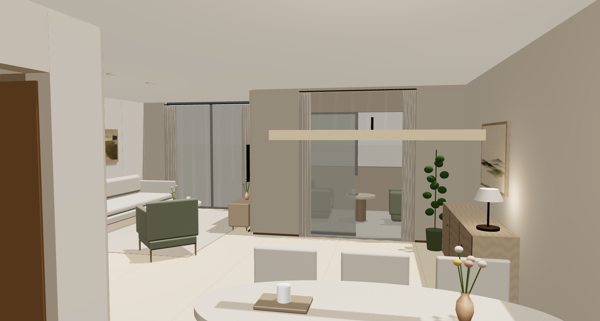

- درجة خشب موحّدة وعلويات مطبخ عاجية، مع أرضية حجرية فاتحة في المساحات العامة وخشب في غرف النوم والدريسنج.
- شيد كتاني فاتح للأباجورات، تعليق خطي فوق السفرة، ولوحات مرتبطة بالكنبة والبوفيه ووحدة تخزين غرفة ١.
- خلفيات هادية لغرف النوم، ورأس سرير منجد لغرفة ٢. مواقع ومقاسات الأثاث والأجهزة محفوظة.

[المقارنة التفاعلية](review.html) تعمل عند تنزيل المجلد مع الصور وفتح الملف في المتصفح. الصور التالية تظهر مباشرة على GitHub.

المعيشة · قبل وبعد

كنبة كتانية، زيتوني محدود، وشيد فاتح مع برونز مطفي. لوحة أفقية مرتبطة بعرض الكنبة؛ الطاولات ومساحة الجلسة محفوظة.

**قبل**

**المقترح**

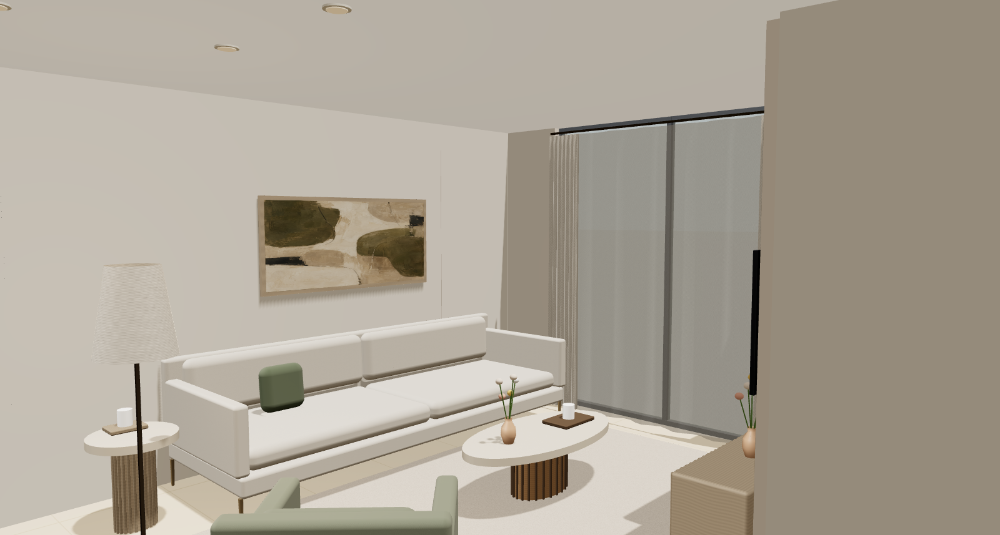

السفرة والبوفيه · قبل وبعد

طاولة ٢٠٠ × ٩٥ سم وستة كراسي. تعليق خطي بعرض ١١٠ سم، ولوحة فوق البوفيه؛ زجاج التراس والنبتة ظاهرين دون إضافة قطع أرضية.

**قبل**

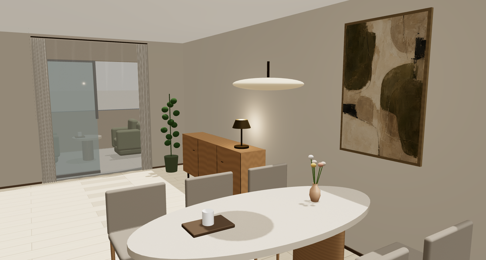

**المقترح**

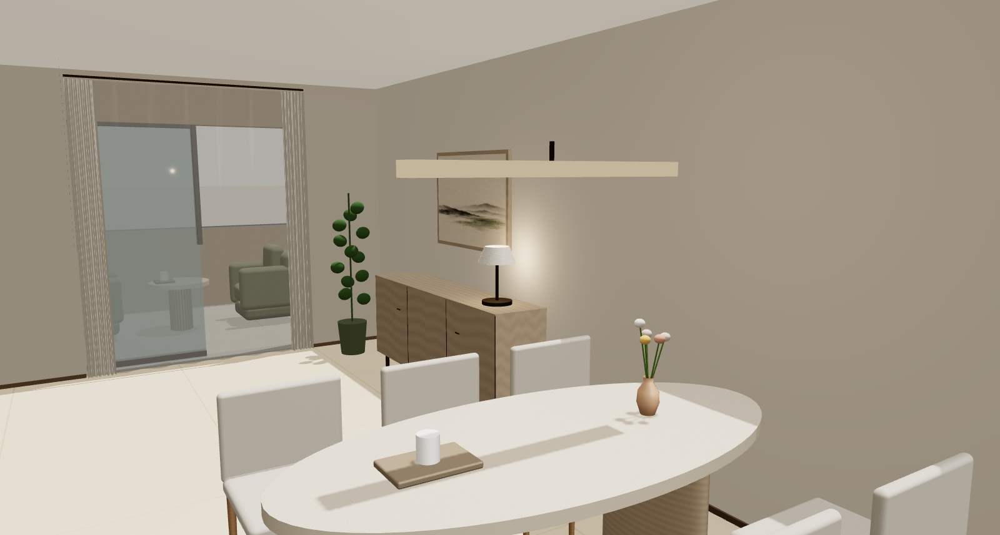

المطبخ · قبل وبعد

قواعد خشبية هادئة وعلويات عاجية وسطح فاتح. الثلاجة ٦٥ × ٦٥ سم والغسالات ٦٠ × ٦١ سم حجوزات قياسية في هذه الجولة.

**قبل**

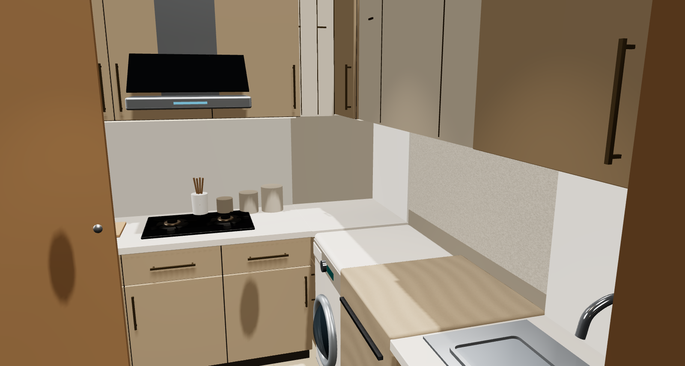

**المقترح**

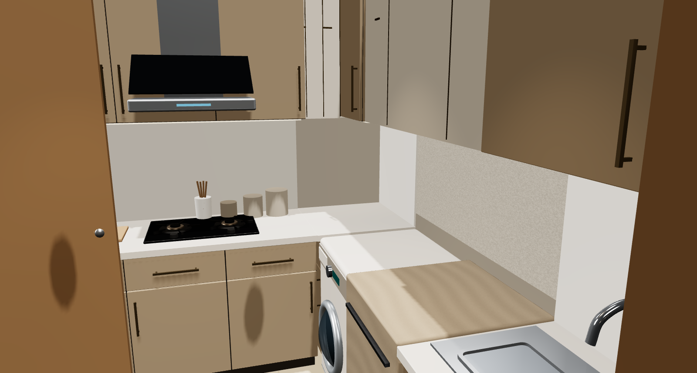

غرفة النوم الرئيسية · قبل وبعد

خلفية تاوب خفيفة تفصل رأس السرير المنجد عن الجدار. الكتان وخشب الكومود يتكرران من الريسبشن، مع الأرضية الخشبية في الجزء الخاص.

**قبل**

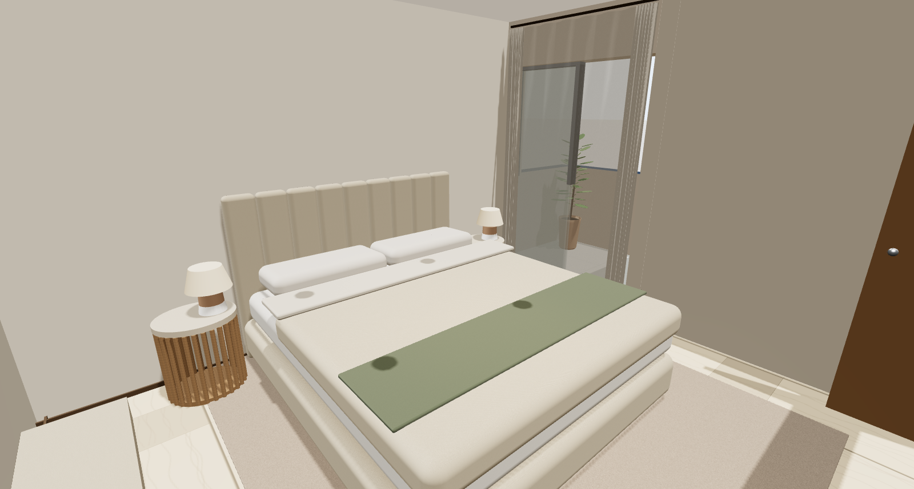

**المقترح**

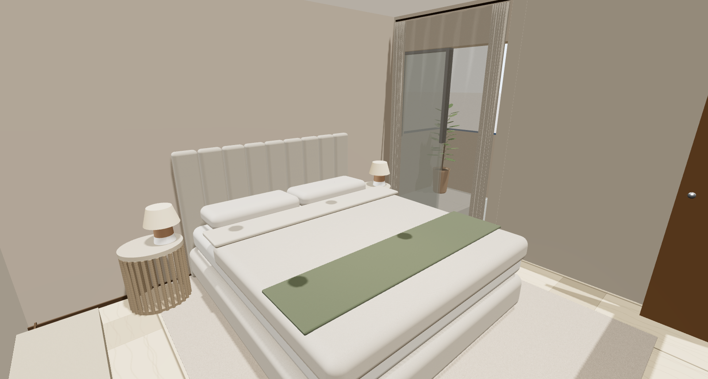

غرفة ١ · المكتب والتخزين · قبل وبعد

اللوحة الرأسية أصبحت فوق وحدة التخزين الجديدة وبعرض ٤٠ سم يناسب الجدار. المكتب ١١٠ × ٦٠ سم ومواقع الأثاث محفوظة.

**قبل**

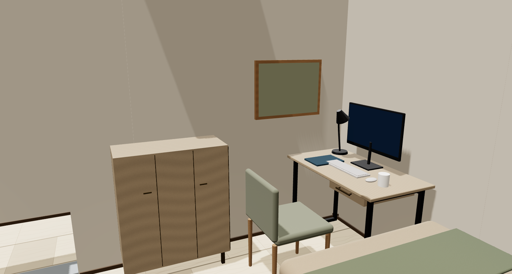

**المقترح**

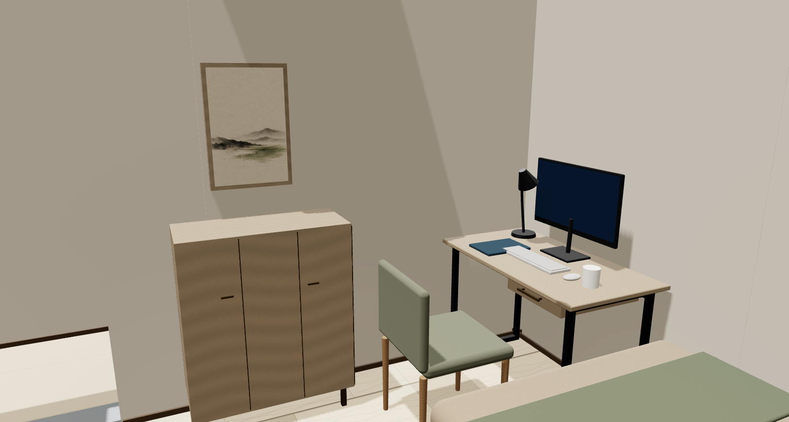

غرفة ١ · السرير والشباك · قبل وبعد

خلفية خضراء شاحبة وراء السرير، خشب هادي وواجهات دولاب عاجية. جهة الشباك تظل خالية من وحدات التخزين.

**قبل**

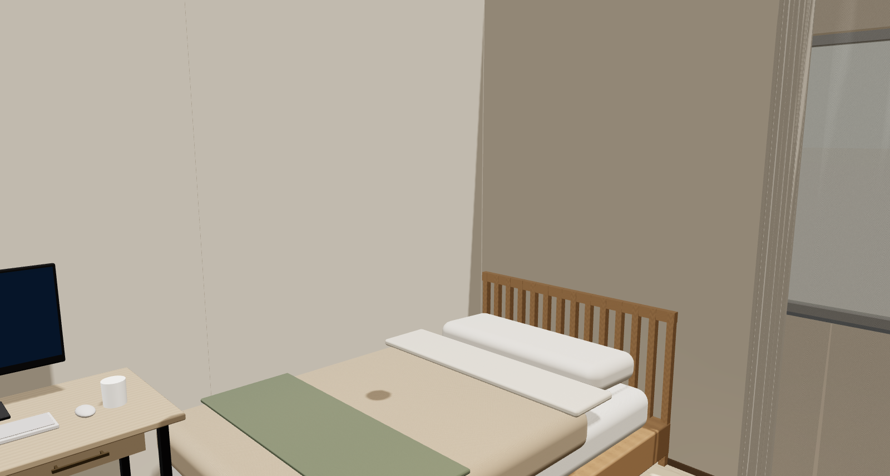

**المقترح**

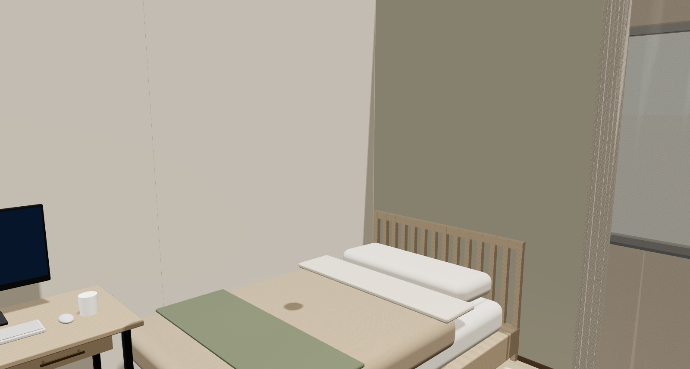

غرفة ٢ · قبل وبعد

رأس سرير منجد وخلفية تاوب وعمل تجريدي دافئ بدل الحقل اللوني المسطح. الإطار الخشبي يكرر خامة الأثاث دون إطار داكن ثقيل.

**قبل**

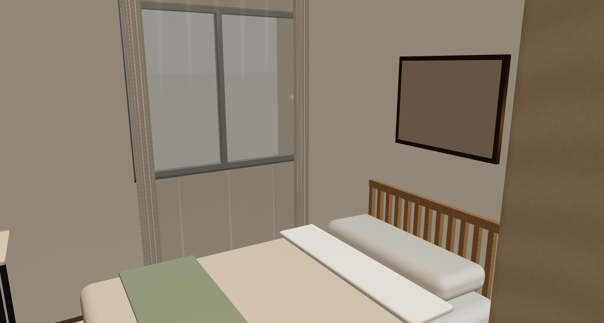

**المقترح**

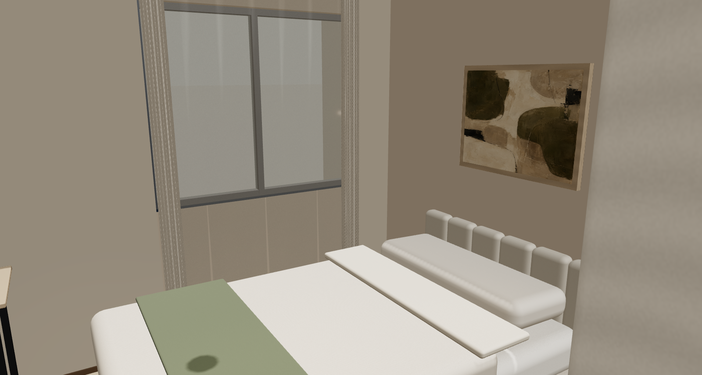

حمام الغرفة الرئيسية · قبل وبعد

حجر فاتح، خشب هادي ونيكل. وحدة الحوض مقفولة والمقاسات محفوظة؛ لا إضافة لديكور أرضي داخل مساحة الاستخدام.

**قبل**

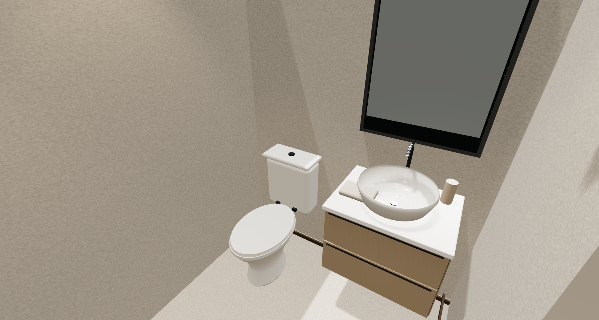

**المقترح**

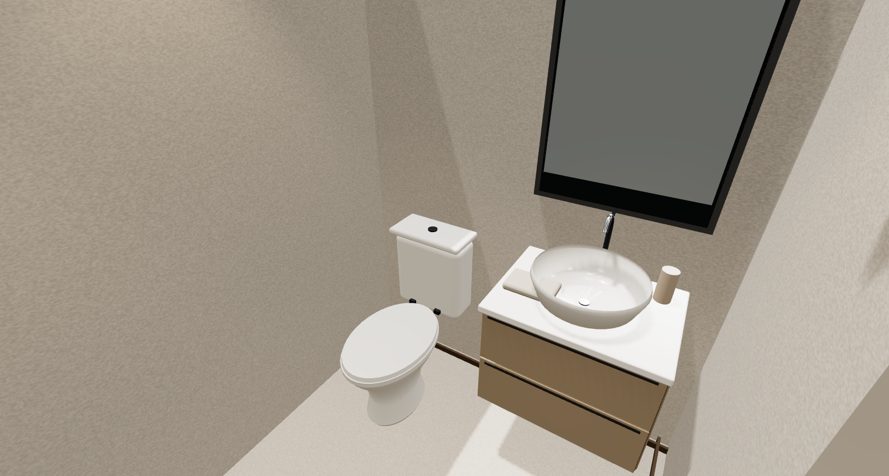

حمام العائلة · قبل وبعد

نفس عائلة خامات الحمام الرئيسي: فاتح مع فرق بسيط عند حائط الدش، وخشب هادي تحت الحوض.

**قبل**

**المقترح**

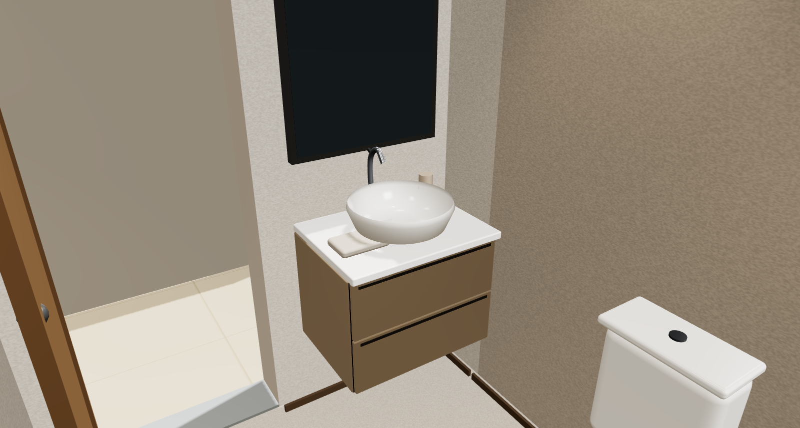

المعيشة · قراءة ليلية · قبل وبعد

نفس زاوية المعيشة في وضع الليل الساعة ٢١. لقطة مفاهيمية لقراءة توازن المصابيح والإضاءة العامة؛ لا تمثل حساب لوكس أو مخطط كهرباء.

**قبل**

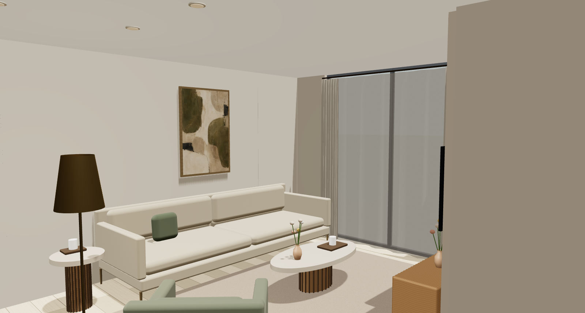

**المقترح**

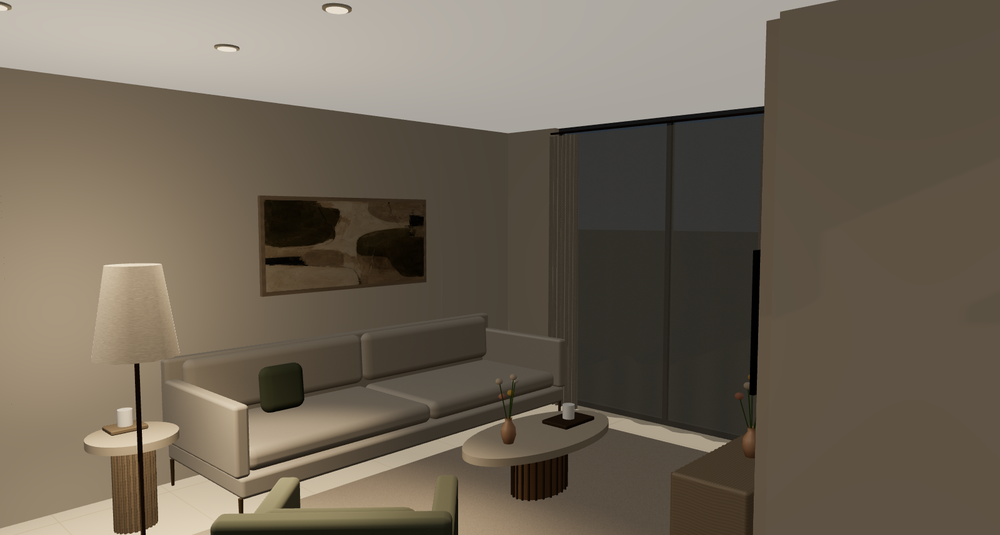

الفحص الثابت: **0 فشل**، مع 76 ملاحظة محفوظة. الحركة تحتفظ بنتائج المراجعة الموحّدة: ٢٦٦ استعلامًا، منها ٢٤٠ مسارًا موجودًا؛ ٢٢٨ أعيد حسابها و٣٨ مطابقة للمصدر. في الوضع المقفول ومع إشغال السفرة توجد مسارات إلى ١٨ من ١٩ وجهة بالدقتين. فتح التخزين يحجب وقفة المكتب، وتفريغ غسالة الأطباق يحجب تراس الخدمة مؤقتًا. [تفاصيل الحركة](../unified-furnishing-v55/README.md).

الصور رندر مفاهيمي من النموذج بنفس الزوايا وحالات الأبواب. الإضاءة والخامات وأمثلة اللوحات ليست مواصفات منتجات أو حسابًا ضوئيًا. هذه **نسخة مراجعة منفصلة** عن التصميم السحابي النشط؛ المعمار والفتحات والسقف ٢٫٥٠ م محفوظة.

المصدر `scene-c9c055c1` · المقترح `scene-497a734f` · [ملف التعديلات](proposal.json) · [نسخة التصميم](brief.json).
